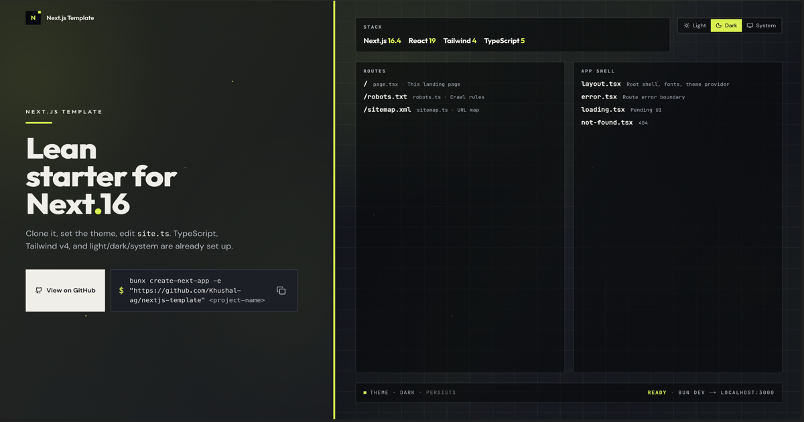

<div align="center">

# Next.js Starter Template

**Lean starter for Next.js 16.** Clone it, set the theme, edit `site.ts`.

[](https://nextjs.org/)
[](https://react.dev/)
[](https://tailwindcss.com/)
[](LICENSE)

<br />



</div>

<br />

```
Next 16 · React 19 · Tailwind 4 · TypeScript
App Router · Cache Components · React Compiler
light · dark · system  ·  MIT
```

## Quick start

```bash
bunx create-next-app -e "https://github.com/Khushal-ag/nextjs-template" <project-name>
```

Or clone the repo:

```bash
bun install
bun dev
```

Then open [localhost:3000](http://localhost:3000) and edit `src/config/site.ts`.

| Step | Command | What it does |
| ---- | ------- | ------------ |
| 01 | `bun install` | Dependencies + Husky hooks |
| 02 | `bun dev` | Turbopack, Cache Components on |
| 03 | `bun run validate` | Lint, types, Prettier, production build |

> Node.js ≥ 20.20.2. Prefers [bun](https://bun.sh/); npm, yarn, and pnpm work too (drop `bun.lock` first).

## What's included

| | |
| --- | --- |
| **Routing** | App Router, Cache Components, React Compiler |
| **Style** | Tailwind v4, CSS variables, theme switcher |
| **Quality** | ESLint 10, Prettier, Husky, lint-staged |
| **SEO** | Metadata, OG/Twitter, JSON-LD, robots, sitemap |

Also ships: `error.tsx`, `loading.tsx`, `not-found.tsx`, PWA manifest icons, and security headers in `next.config.ts`.

## Theme

Soft-technical tokens: warm paper, deep slate, chartreuse accent. Outfit + DM Sans on the page; JetBrains Mono in the studio.

Light, dark, and system modes via `next-themes`. Toggle lives in the header / studio. Tokens sit in `src/styles/globals.css` (`:root` + `.dark`). Preference persists in `localStorage`.

Keep the toggle, restyle the variables, or remove `client-components.tsx` if you drop theming entirely.

## Scripts

| Script | Description |
| ------ | ----------- |
| `dev` | Dev server (Turbopack) |
| `build` | Production build |
| `start` | Serve production build |
| `preview` | Build and serve |
| `lint` | ESLint + TypeScript |
| `lint:fix` | ESLint with auto-fix |
| `type-check` | TypeScript only |
| `fmt` / `fmt:check` | Prettier write / check |
| `validate` | Lint + format check + build |
| `ui` | shadcn CLI |
| `clean` / `cleani` | Clear `.next` / reinstall |

## Structure

```
src/
├── app/                 # Routes, layout, SEO (robots, sitemap)
├── components/          # Shared UI (theme provider)
├── config/site.ts       # Name, URL, SEO, links — edit after fork
├── lib/                 # Utilities, fonts
└── styles/globals.css   # Design tokens + Tailwind @theme
```

## Customize

1. Update `package.json`, `README.md`, and `LICENSE`
2. Edit `src/config/site.ts` (name, description, URL, authors, links)
3. Replace `src/app/page.tsx` with your product
4. Set `NEXT_PUBLIC_SITE_URL` in `.env` when needed (see `.env.example`)
5. For remote `next/image` hosts: `NEXT_PUBLIC_IMAGE_HOSTS=images.example.com,cdn.example.org`

## License

MIT. See [LICENSE](LICENSE).

---

<div align="center">

[GitHub](https://github.com/Khushal-ag/nextjs-template)
·
[Khushal-ag](https://github.com/Khushal-ag)

</div>
